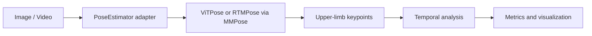
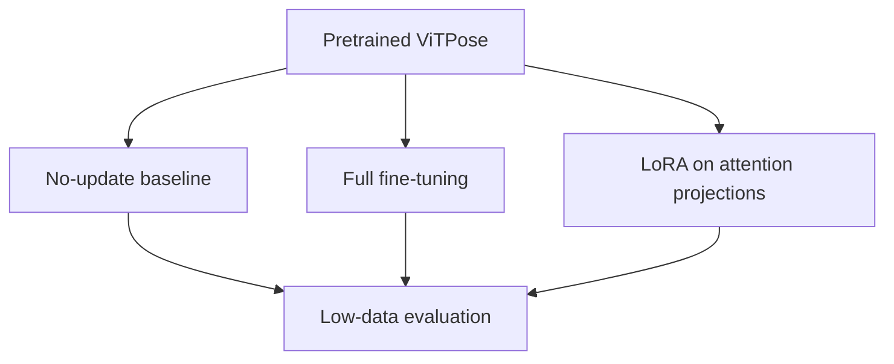

# PoseAdapt

**Parameter-Efficient Fine-Tuning for Low-Data Human Pose Estimation in Video**

PoseAdapt is a research engineering project for adapting pretrained Vision Transformer pose models
when labelled data is scarce. It is being developed as a reproducible pipeline around MMPose,
ViTPose, COCO keypoints, LoRA, upper-limb movement analysis, temporal filtering, and controlled
robustness evaluation.

> **Current status:** Phase A (project foundation) and the Phase B image-inference MVP are
> implemented. Real checkpoint-backed inference has not yet been run in this repository. Video,
> training, LoRA, benchmark metrics, and robustness experiments remain **Not Run / TBD**.

## Motivation

Large pretrained pose models offer strong generic representations, but domain-specific projects may
have few labels, shifted image statistics, or landmarks that differ from public datasets. PoseAdapt
asks whether parameter-efficient updates can recover useful pose accuracy while training only a small
fraction of model parameters. Its upper-limb outputs describe image-space movement; they are not a
medical diagnosis and should not be interpreted as one.

## Research Questions

1. Can LoRA adaptation of ViTPose approach full fine-tuning under 20%, 10%, and 5% COCO data?
2. How do pretrained, fully fine-tuned, and parameter-efficient models respond to blur, noise,
   darkness, JPEG compression, and partial occlusion?
3. How stable are shoulder, elbow, and wrist predictions in video?
4. How much jitter can EMA and Kalman filtering remove, and what temporal lag do they introduce?

## Architecture





The model interface is independent of the concrete MMPose architecture. The initial top-down image
MVP uses a full-image person region. A detector/tracker will be integrated for multi-person video in
Phase C.

## Implemented Features

- Installable `src/` package with typed estimator and prediction interfaces
- Lazy MMPose integration for ViTPose and RTMPose configuration files
- CPU/CUDA/automatic device selection with clear validation
- Headless OpenCV image decoding, COCO skeleton rendering, and upper-limb highlighting
- Optional JSON output containing keypoints, confidence, person box, and instance score
- YAML configuration with deterministic, recursive base-file inheritance
- Synthetic unit tests that need no model or dataset download
- CPU-oriented Docker foundation and explicit local-path validation

## Compatibility and Installation

For the complete OpenMMLab stack, use **Python 3.10 or 3.11**. MMPose 1.x is paired with MMCV 2.x,
MMEngine 0.x, and (when person detection is added) MMDetection 3.x. Full MMCV wheels are compiled for
specific PyTorch/CUDA combinations; installing an unmatched combination can trigger a slow or failed
source build. Never install `mmcv` and `mmcv-lite` together.

Install the core utilities:

```bash
python -m venv .venv
# Linux/macOS: source .venv/bin/activate
# Windows PowerShell: .venv\Scripts\Activate.ps1
python -m pip install --upgrade pip
python -m pip install -e ".[dev]"
pytest
```

For pose inference, first install PyTorch using the command generated for your CPU or CUDA platform at
the [official PyTorch installer](https://pytorch.org/get-started/locally/), then install the compatible
lightweight inference stack:

```bash
python -m pip install -e ".[openmmlab,dev]"
```

The optional extra pins `mmpose==1.3.2`, `mmcv-lite>=2.0.1,<2.2.0`, and
`mmengine>=0.7.1,<1.0.0`. `mmcv-lite` is sufficient for the current top-down ViTPose path and avoids
compiling CUDA operators. A later detector-backed pipeline may require full MMCV and MMDetection;
those versions will be pinned and tested together before being made part of the supported setup.

## Pretrained Image Inference

Obtain a model configuration and checkpoint from the official
[MMPose model zoo](https://mmpose.readthedocs.io/en/latest/model_zoo/2d_body_keypoint.html). PoseAdapt
does not download or execute checkpoints automatically. Review the source and pass local files:

```bash
python scripts/infer_image.py \
  --input examples/person.jpg \
  --output outputs/person_pose.jpg \
  --model vitpose \
  --model-config path/to/mmpose/vitpose_config.py \
  --checkpoint path/to/official_vitpose_checkpoint.pth \
  --device auto \
  --json-output outputs/person_pose.json
```

The same values can be placed in `configs/inference.yaml`. The CLI returns exit code 2 with a concise
message for missing inputs, weights, optional dependencies, or unavailable CUDA.

## Dataset Preparation

COCO is not downloaded automatically. See `data/README.md` for the expected layout. Deterministic,
seeded 100%, 20%, 10%, and 5% randomized subset generation is planned for Phase F; it is not yet
implemented.

## Training and Low-Data Benchmark

Full fine-tuning, LoRA injection, experiment provenance, TensorBoard logging, COCO evaluation, and the
experiment matrix are planned for Phases G–I. No training command currently claims to work, and no
checkpoints or metrics are included.

## Temporal and Robustness Analysis

EMA/Kalman trajectory filtering and temporal smoothness metrics are planned after the video pipeline.
Controlled corruptions and clean-to-corrupted degradation evaluation follow in Phase J. Temporal
smoothness metrics will be reported as motion regularity measures, not as pose accuracy unless labelled
trajectories are available.

## Results

**Experimental results will be added after benchmark execution.**

| Strategy | Data fraction | COCO AP | Upper-limb metric | Status |
|---|---:|---:|---:|---|
| Pretrained | N/A | N/A | N/A | Not Run |
| Full fine-tuning | 100/20/10/5% | TBD | TBD | Not Run |
| LoRA | 100/20/10/5% | TBD | TBD | Not Run |

No benchmark values, training logs, plots, or model checkpoints have been fabricated.

## Reproducibility

The current configuration records the intended seed and model paths. Later experiment phases will
persist the resolved YAML, Git commit, package versions, timestamp, metrics, logs, memory use, and
checkpoint under a unique `runs/` directory. Generated data, runs, and weights are ignored by Git.

## Docker

Build and inspect the lightweight CPU image:

```bash
docker build -t poseadapt:cpu .
docker run --rm poseadapt:cpu --help
```

Mount local images and explicitly pass model files when the image contains an OpenMMLab environment.
GPU execution will use the NVIDIA Container Toolkit and a CUDA-matched PyTorch/MMCV base in a later,
tested Docker profile.

## Project Structure

```text
configs/                 YAML runtime configuration
data/                    dataset layout documentation; datasets are ignored
src/poseadapt/
  cli/                   command-line implementations
  models/                backend-neutral API and MMPose adapters
  utils/                 configuration, device, and logging utilities
  visualization/         COCO skeleton renderer
scripts/                 source-tree command wrappers
tests/                   tiny synthetic tests
experiments/             experiment protocol notes
results/                 tracked empty output directories
```

## Limitations

- 2D keypoints do not provide true anatomical 3D positions.
- Public generic keypoint datasets differ from healthcare-specific landmarks and acquisition settings.
- The current image MVP assumes the full frame contains one person and has no detector or tracker.
- Temporal smoothing may reduce jitter while introducing lag.
- Synthetic corruptions cannot represent every real acquisition problem.
- No accuracy, speed, temporal, robustness, or memory benchmark has been run yet.

## Roadmap

- Video decoding, multi-person detection/tracking, and polished overlays
- Upper-limb angles, vectors, velocity, acceleration, and trajectory smoothness
- EMA and Kalman filtering with missing-observation handling
- Deterministic COCO low-data subsets
- Full fine-tuning and targeted attention LoRA with parameter accounting
- COCO OKS metrics and clearly named per-joint normalized errors/PCK
- Dynamic robustness corruptions and degradation plots
- 3D pose lifting, learned temporal refinement, and Mamba-style sequence models
- Domain-specific and few-shot keypoint adaptation
- Uncertainty estimation and diffusion-based pose refinement
